<picture>
  <source media="(prefers-color-scheme: dark)" srcset="frontend/public/Logo/Poseidon_White.png">
  
</picture>

# POSEIDON

Found live at this link: https://192-248-153-178.sslip.io/

POSEIDON watches live ship tracking (AIS) and flags ships that go quiet while other ships in the same area keep reporting. It gives an analyst a short list of candidates, a risk estimate for each ship, a replay of the picture, and a shared workspace for a team. It was built at HackTheBurgh.

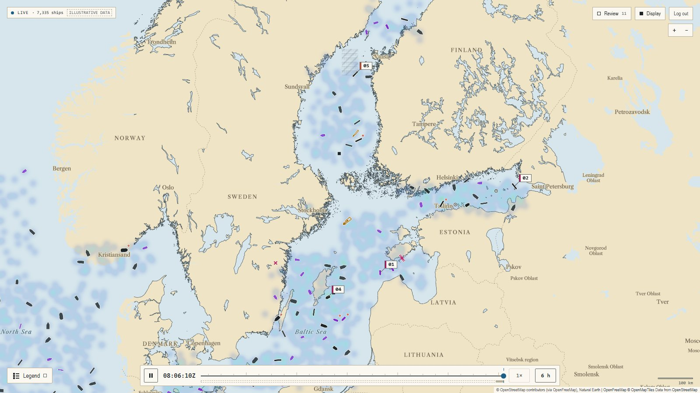

**The pictures in this README are illustrative.** They were captured on a demo data set. Ships named SYN are synthetic, and the sample briefing text is demo content. Nothing in a picture is a finding about a real vessel, and the pictures do not show what the live feed says today.

## Contents

- [The problem](#the-problem)
- [What it does](#what-it-does): [the live picture](#the-live-picture), [dark-ship candidates](#dark-ship-candidates), [the ship window](#the-ship-window), [predictions and risk](#predictions-and-risk), [review list and briefings](#review-list-and-briefings), [replay](#replay), [collaboration](#collaboration), [extras](#extras)
- [How it works](#how-it-works)
- [Models and results](#models-and-results)
- [Data sources](#data-sources)
- [Run it locally](#run-it-locally)
- [Project layout](#project-layout)
- [How we built it](#how-we-built-it)
- [Team](#team)

## The problem

AIS is the radio system that ships use to broadcast their position, speed and identity. A ship that switches its AIS transmitter off stops appearing on the map. Off is not always illegal: a master may switch it off for safety. Going dark is also one way to hide illegal fishing, transfers at sea and sanctions evasion.

How big is it? A 2022 study of Global Fishing Watch data for 2017 to 2019 found more than 55,000 suspected AIS-disabling events. Together they hid nearly 5 million hours of fishing activity. The authors put the share of vessel activity hidden this way at up to 6%, and more than 40% of the hidden hours fell in four hotspots, three of them areas of illegal-fishing concern ([Welch et al., *Science Advances* 8(44), 2022, DOI 10.1126/sciadv.abq2109](https://doi.org/10.1126/sciadv.abq2109); [summary by UC Santa Cruz via ScienceDaily](https://sciencedaily.com/releases/2022/11/221102141349.htm)).

**Who is hurt.** Coastal states lose the ability to see who is fishing in their waters and in their protected areas. Fishers who follow the rules compete with boats that do not show where they are.

**Why it is urgent.** The satellite data that shows the hidden ships arrives late. Global Fishing Watch presence data is about 3 to 4 days old when it lands, and Sentinel-1 radar scenes arrive 1 to 13 hours after they were taken. Among the feeds we use, only AIS arrives within seconds. An operator who wants to act today has to ask which ships went quiet in the last hour, and AIS is the only source that can answer that. POSEIDON answers it from live AIS and keeps the late data next to it, so a flag can be checked against what satellites saw later.

## What it does

### The live picture

A world map shows ships from AISStream and, for Finnish waters, from Digitraffic (Fintraffic). The two feeds are merged, so a ship heard by both is shown and stored once. A status line shows the connection, how many ships are on screen and the message rate. Ships are drawn as one GPU layer, so the whole world stays smooth. Class A and Class B ships use colours that are readable for people with colour-vision differences, and there is a heat map, which can show the live density or popular places.

<table>
  <tr>
    <td width="50%">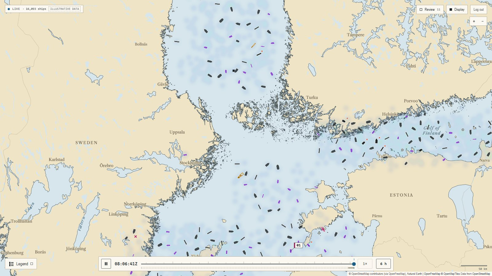</td>
    <td width="50%">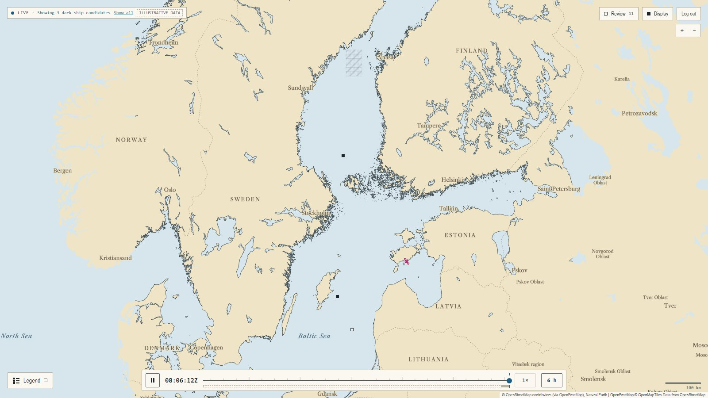</td>
  </tr>
  <tr>
    <td>Zoomed in on the Gulf of Finland. Class A and Class B ships use different colours, and headings show the direction of travel.</td>
    <td>The "Show" setting filtered to dark-ship candidates. The pink markers are candidates, not findings.</td>
  </tr>
</table>

### Dark-ship candidates

The gap detector runs on Class A ships. A ship is a **candidate** when it has been silent for at least 30 minutes, or for 20 times its usual reporting interval, whichever is longer, while it was moving. Each silence gets one of four labels:

| Label | What it means |
|---|---|
| `deliberate_candidate` | Other ships nearby kept reporting, and this one stopped. The only label drawn as a dark ship on the map. |
| `coverage_gap` | Few other ships nearby reported in the last 10 minutes, so our receiving is likely the cause. |
| `unknown` | Open sea with no other Class A ship heard nearby. We cannot tell. |
| `own_stall` | POSEIDON's own feed was down for part of the silence. |

Silences at anchor or moored are not gaps. Our own outages are removed from the judgement. A candidate is a prompt to look, not a finding: the label says the silence *looks* deliberate.

### The ship window

Click a ship and a floating window opens with its name, MMSI, IMO, type, speed, course and destination. It also shows the ship's departure and arrival ports (From → To), its recent track, its open and recent gaps, its risk score and any route prediction. Leader lines tie each window to its ship on the map.

<table>
  <tr>
    <td width="50%">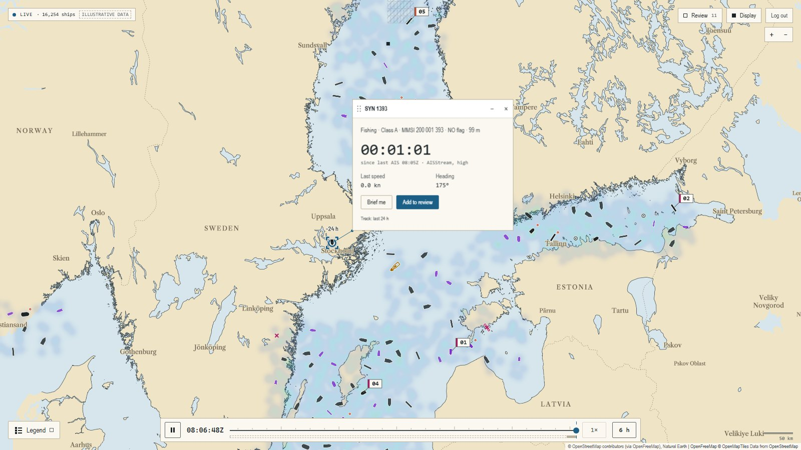</td>
    <td width="50%">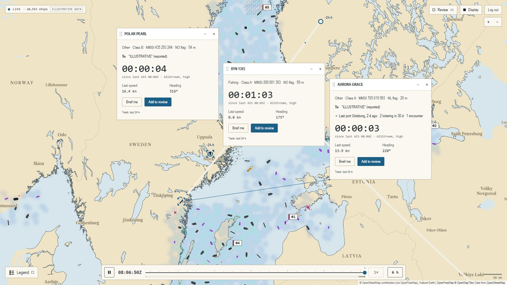</td>
  </tr>
  <tr>
    <td>A ship window: identity, last AIS time and speed, the 24 hour track, and the actions.</td>
    <td>Several ship windows at once. Leader lines tie each window to its ship.</td>
  </tr>
</table>

### Predictions and risk

- **Route.** For a ship that has gone quiet, the route model estimates where it is likely to be at several time points up to 24 hours later. Each estimate comes with an 80% circle and a 95% circle, so the picture shows how far the ship could have moved, not one point. On our own feed the first circles were too small; the recalibrated radii are in [Models and results](#models-and-results).
- **Go-dark ranking.** Each moving ship is scored for how likely it is to go dark within 6 hours, and the ships are ranked. The scores are frozen once an hour, so they can be checked later. **The ranking is weak on our own feed.** Its AUC is 0.59 at 1 hour and 0.63 at 6 hours. The top 10% of ships went dark about twice as often as the average within 6 hours. So POSEIDON shows go-dark as an order with reasons, not as a percentage.
- **Watchlist.** The top 50 ships in the ranking, each with reason codes: `HIGH_FORECAST`, `OPEN_GAP`, `RECENT_GAP`, `DRAUGHT_JUMP` (draught changed by a metre or more across a recent gap) and `BLANK_DESTINATION`. The reasons are the part to read; the rank alone is a weak signal.
- **Forecast check.** Each frozen set is graded once its window closes. A forecast counts as a hit or a miss, or is marked censored when our data had a hole.

With no trained model loaded, every ship gets the same baseline risk, so the ranking carries no information. The ranking becomes useful once a trained champion model is loaded (see [Models and results](#models-and-results)).

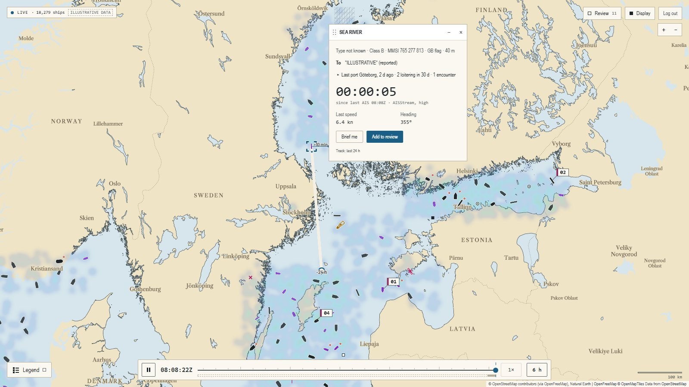

The ship window with its track and course line. The offline demo data has no route forecast overlay, so the route forecast is described from the code, not shown here.

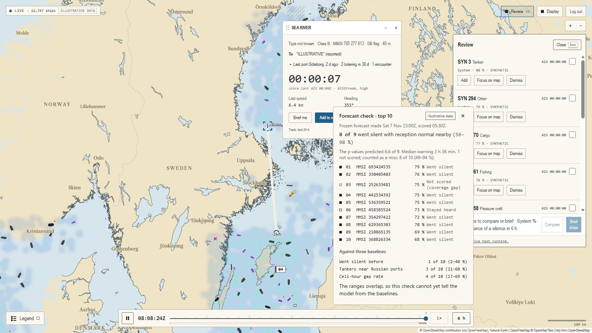

The forecast check for the top 10 ships. It sets the frozen forecast against what happened and against three simple baselines. Here the ranges overlap, so the check cannot yet show that the model beats them.

### Review list and briefings

- **Review list.** A list of ships to look at, kept with the session. Each ship has a status: `open`, `reviewed` or `no_action`. The wording is deliberately neutral: "A flag is a prompt to review, not an accusation."
- **Compare.** Put two or more ships side by side.
- **Brief me.** A Gemini summary of the picked ships. It says whether the model flagged a ship, and why, or whether a user added it. An optional spoken version uses ElevenLabs.
- **Session summary.** Any member can ask for a summary of the session's notes, saved briefings and listed ships.

<table>
  <tr>
    <td width="50%">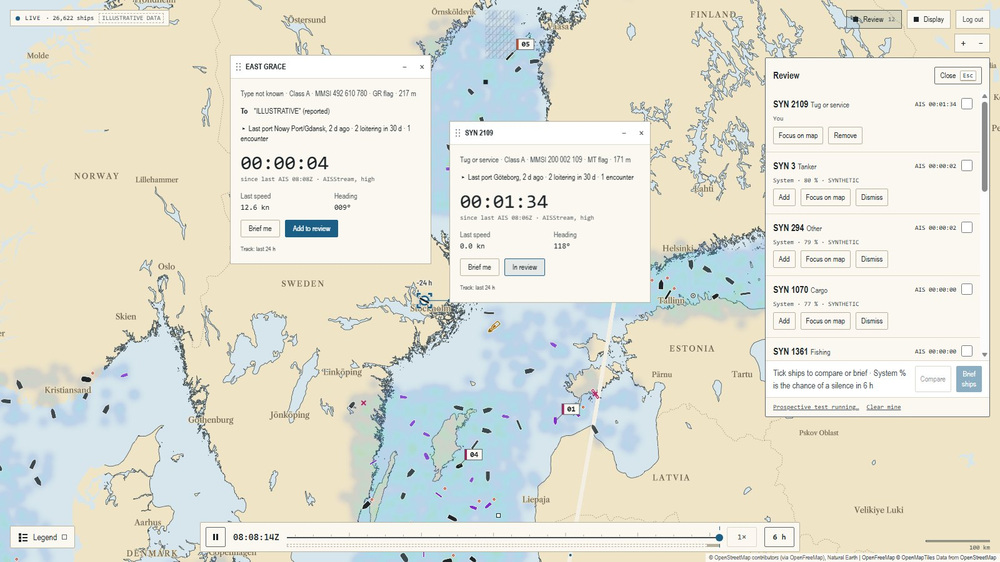</td>
    <td width="50%">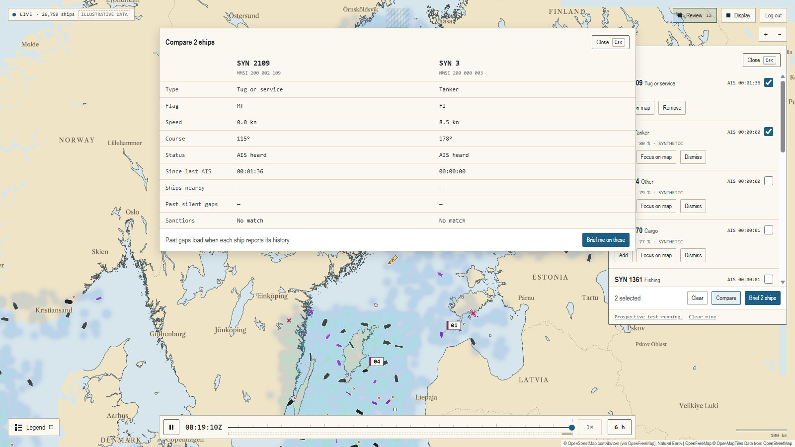</td>
  </tr>
  <tr>
    <td>The review list: system-ranked ships with their scores, and a ship added by a user, with Focus on map and Dismiss.</td>
    <td>Compare two ships picked in the review list, side by side.</td>
  </tr>
</table>

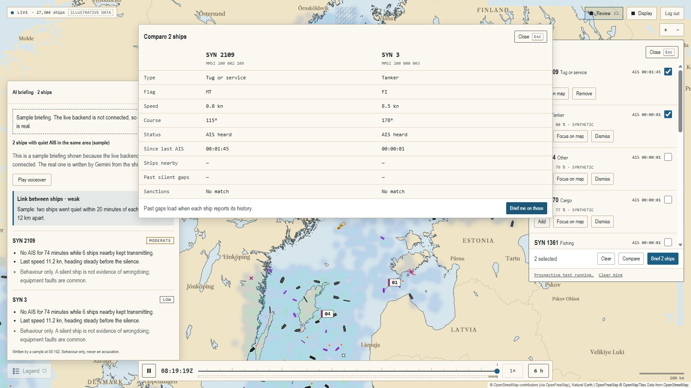

A briefing for two ships, shown as a sample because no live backend was connected when it was captured. In the live system, Gemini writes the text from the ships' data. Each ship's reasons are the signals behind it, and the briefing says that a silent ship is not evidence of wrongdoing.

### Replay

A scrub bar takes the picture back to any moment in the stored history. Play it at 1×, 10×, 60× or 300× real speed, or pause. Gaps, risk, the watchlist and route predictions are all shown as they were at the replay time. Seeking to a time across the whole world takes about 5 seconds.

<table>
  <tr>
    <td width="50%">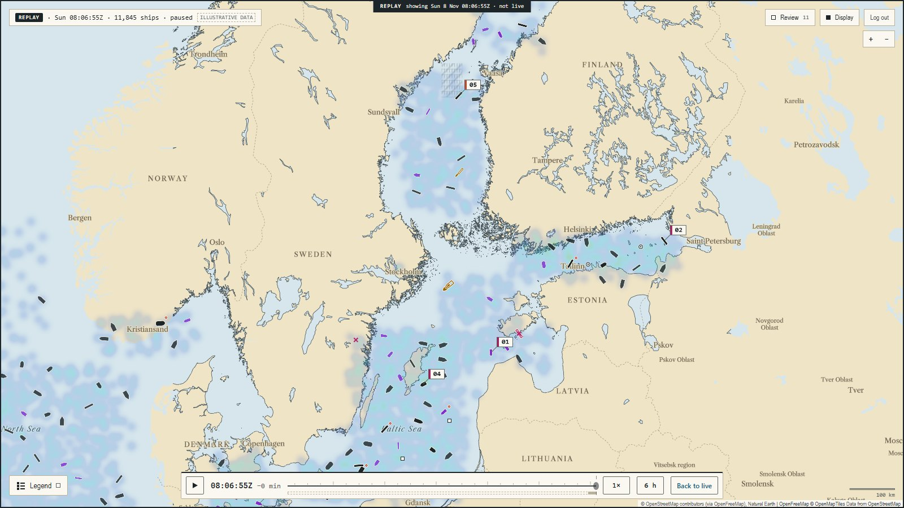</td>
    <td width="50%">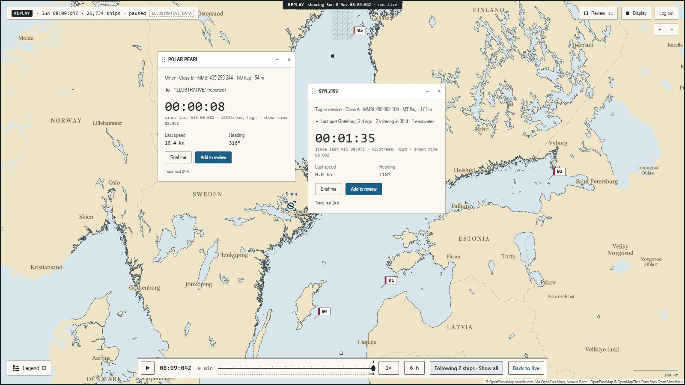</td>
  </tr>
  <tr>
    <td>Replay mode with the scrub bar, the timestamp, the speed and Back to live.</td>
    <td>Replay with "Follow selected" on for two ships. The button reads "Following 2 ships".</td>
  </tr>
</table>

### Collaboration

A team works in a **session**. An owner invites people with a one-time link that lasts 7 days, or by email to someone who has signed in. Members see who is viewing and following which ship, share the review list and notes, and read an activity log. A member can set their presence to private and still see others. A session resumes when you sign in again.

The collaboration pictures below come from a local run with two demo users and the demo ship set. They are illustrative too, and the names in them are demo names.

<table>
  <tr>
    <td width="50%">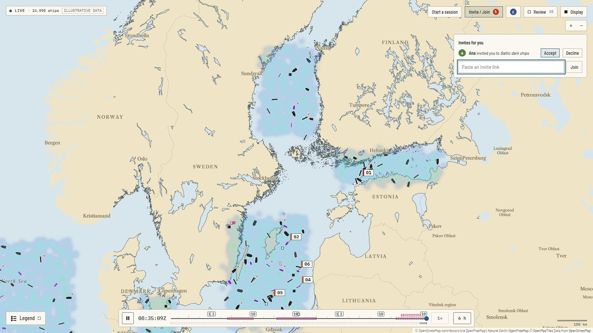</td>
    <td width="50%">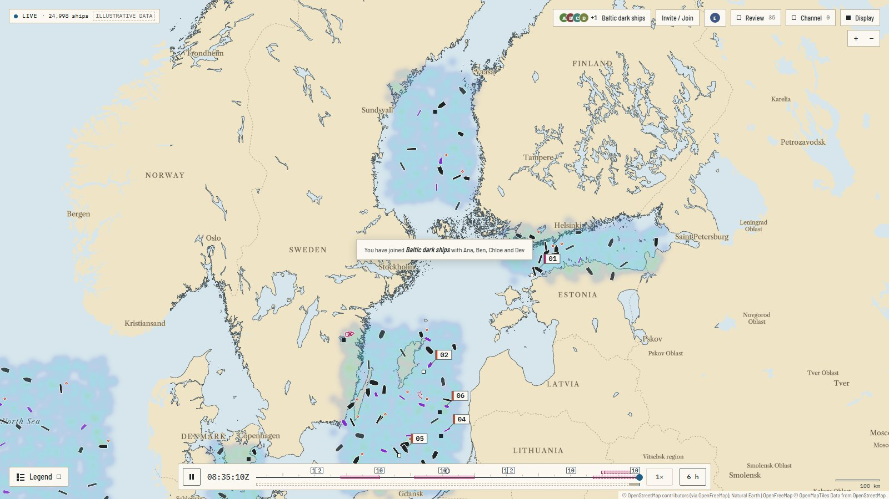</td>
  </tr>
  <tr>
    <td>An incoming invite, with Accept and Decline.</td>
    <td>After joining, a short confirmation names the session and its members.</td>
  </tr>
</table>

<table>
  <tr>
    <td width="50%">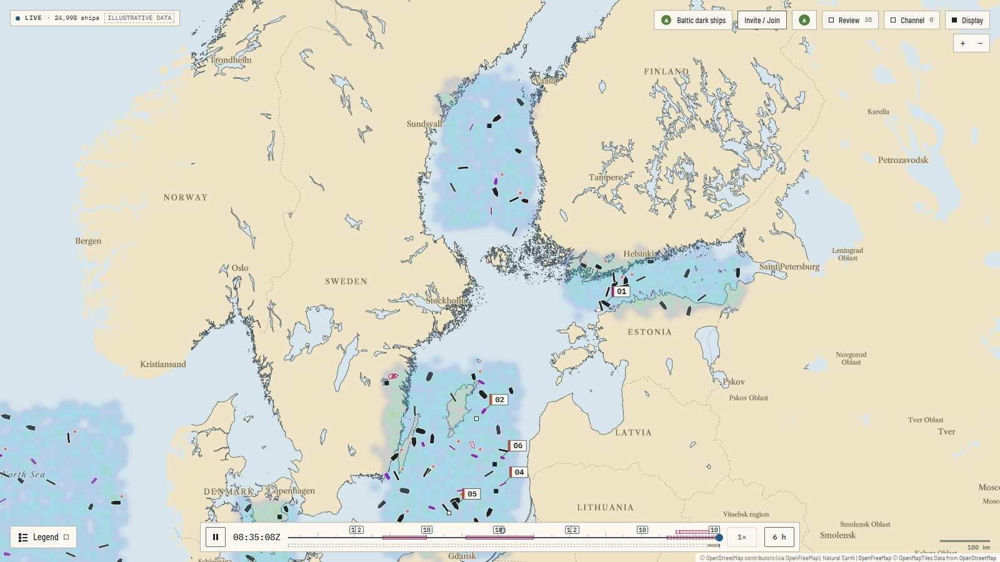</td>
    <td width="50%">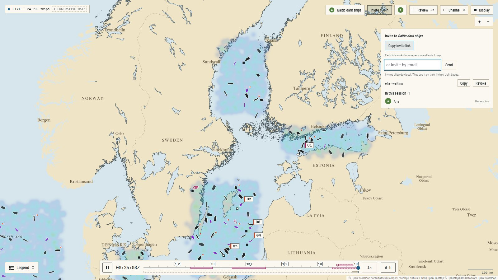</td>
  </tr>
  <tr>
    <td>The session bar with the session title, the Invite / Join button and the member face.</td>
    <td>The invite panel: a pending invite, and the member list with the owner marked.</td>
  </tr>
</table>

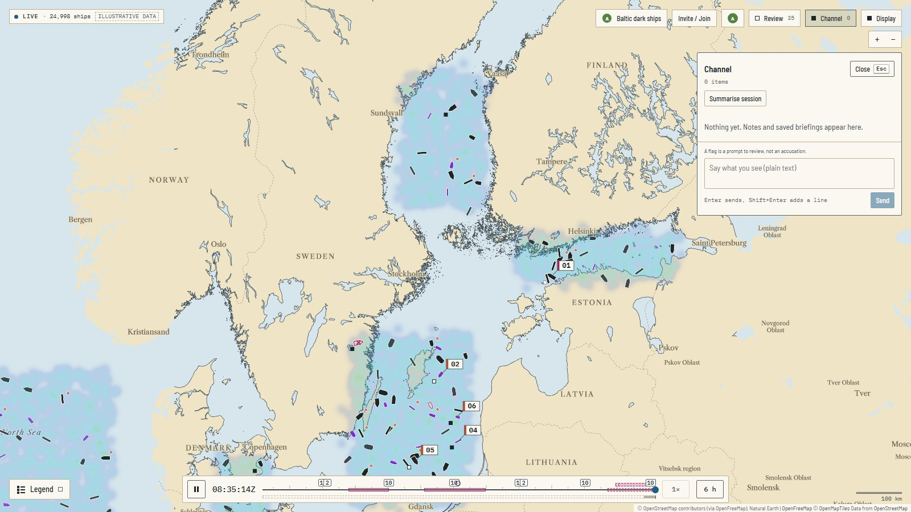

The session channel, empty in this run. It carries the same neutral wording as the review list.

## Extras

These are useful, but they are not the main job of the product.

- **Yachts.** Sanctioned and notable yachts, looked up by IMO number. A sanctioned vessel only shows here when it is on the notable list or when AIS calls it a pleasure or sailing craft. Sanctions and owner links are shown as *reported*, never as established fact.
- **Delayed data.** Global Fishing Watch radar detections, Sentinel-1 radar coverage and Global Fishing Watch gap events, each with its age, so the late data is never mistaken for live.
- **Popular places.** Where ships spend time, from Global Fishing Watch presence data.
- **Digitraffic.** A second live feed for Finnish waters.
- **Themes.** Light, dark, high-contrast and larger text, with a colour-vision signal mode.

<table>
  <tr>
    <td width="50%">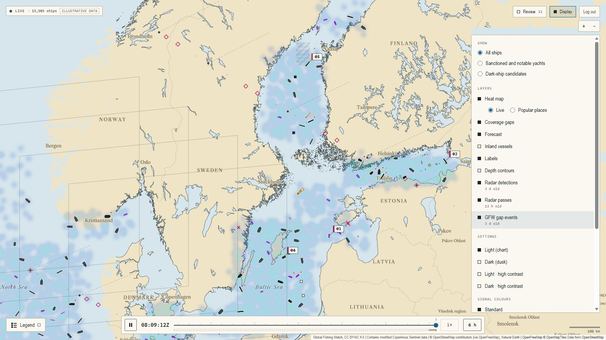</td>
    <td width="50%">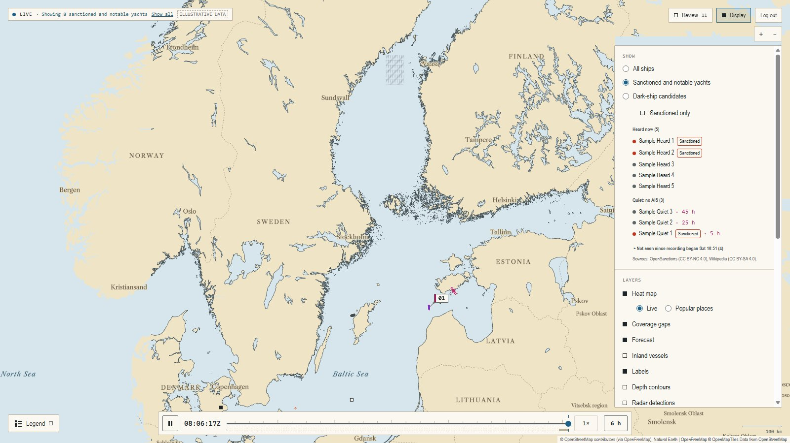</td>
  </tr>
  <tr>
    <td>The delayed layers, each with its age. Radar and gap events are never shown as live.</td>
    <td>"Show" set to sanctioned and notable yachts. The panel credits OpenSanctions and Wikipedia.</td>
  </tr>
</table>

## How it works

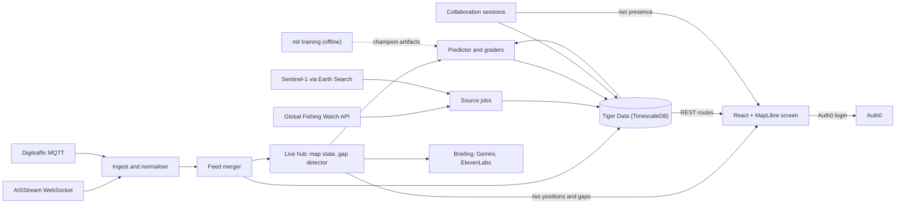

**The path from ship to screen.**

1. **Ingest.** AISStream and Digitraffic messages are normalised into one position record and one identity record. Bad messages are skipped and counted. Both feeds pass through one merger, so a ship heard twice is stored once.
2. **Store.** Positions and identities go to Tiger Data (TimescaleDB, hypertables on time). A continuous aggregate counts messages per 0.1-degree cell per minute, which the gap detector uses as its baseline for how much traffic a place should show.
3. **Detect.** The gap detector sees every position. It opens a gap when a moving ship goes silent, and writes a new version each time the gap's label changes. Rows are append-only.
4. **Observe.** Global Fishing Watch and Sentinel-1 data go into one `observations` table. Each row keeps the time it became public, so a model only uses what was known at the time it predicts.
5. **Predict.** Every 5 minutes the predictor forecasts routes for ships in open gaps and a sample of moving ships, and scores go-dark risk. It writes each prediction to a ledger, then grades the ones whose time has come.
6. **Train offline.** Models are trained on a desktop in `ml/`. Each run is compared on a frozen held-out set. A fixed rule, not a person and not an LLM, decides whether a model becomes the champion. The server loads the champion from an artifact folder.
7. **Show.** The screen is React, Vite and MapLibre. Ship positions skip React and go straight to the map's GPU layers. The WebSocket sends a snapshot, then a delta each second. REST routes serve detail, history and the ledger.

## Models and results

The server runs two trained champions, `route-dma90-v2` and `godark-lgbm-20261108T051156`, and each has a recalibrated `-cal1` version that replaces its radii or probabilities once applied. Each result below is traceable to a team post on the board or a merged PR. The results are not all good, and the table says so.

| Model | Job | Result | Where it is recorded |
|---|---|---|---|
| **Route `route-dma90-v2`** | Where a quiet ship is likely to be at several horizons up to 24 h, with 80% and 95% circles | **Training holdout** (509,061 Danish cases, 90 days of Danish Maritime Authority AIS): skill against dead reckoning 0.365 at 1 h, 0.624 at 3 h, 0.716 at 6 h, 0.795 at 12 h, 0.873 at 24 h. Circles covered 0.79 to 0.81 (80%) and 0.94 to 0.95 (95%). **Our own feed, 11 h backtest** (moving ships): skill 0.141 at 1 h, 0.400 at 3 h, 0.515 at 6 h, so the model is much weaker on our feed. Circles covered only 0.59 to 0.62 (80%) and 0.86 to 0.89 (95%). | Board posts 8 Nov 07:32 (issue #153) and 08:17 (backtest) |
| **Route `route-dma90-v2-cal1`** (radii recalibrated) | Same model, with radii widened by 1.61 to 1.71 (80%) and 1.33 to 1.41 (95%) per horizon, fitted on the first half of 11,648 graded backtest rows | On the later half, unseen in the fit: 80% coverage 0.79 to 0.82 and 95% coverage 0.95 to 0.97. Point predictions are unchanged. | Board post 8 Nov 08:20 (draft release `models-recal-v1`) |
| **Go-dark `godark-lgbm-20261108T051156`** | Ranking of moving ships by how likely they are to go dark within 1 h and 6 h (`deliberate_candidate`) | **Weak.** On our feed, AUC 0.59 at 1 h and 0.63 at 6 h. The top 10% of ships went dark about twice as often as the average within 6 h. The raw probabilities were about twice the hit rate (dark_1h mean 0.022 against a hit rate of 0.0097; dark_6h 0.095 against 0.046), so they are not shown as percentages. | Board posts 8 Nov 08:17 and 08:20 |
| **Go-dark `godark-lgbm-20261108T051156-cal1`** | Same ranking, with the probabilities shifted to match the hit rate | Mean probability now equals the hit rate. The ranking is unchanged. | Board post 8 Nov 08:20 |
| Route `dma90-v1` | First route model | Retired. Its file format is refused by the server loader. | Board post, 8 Nov 06:46 |
| Go-dark from Global Fishing Watch history | Go-dark risk trained on GFW gap events and presence | Rejected by the promotion rule. 30-day skill +0.020 [−0.057, +0.083] with all 2.9 months of history; neither primary interval excludes zero. | PR #154 description (`ml/godark_gfw/`) |

The route model's skill on our own feed is the number to quote when judging it. The Danish holdout figures show what the model does on its training source, not on the worldwide live feed.

The gap detector was replayed offline over the 7 Nov log, 16:51 to 21:57 UTC, 1.65 million messages and 24,615 Class A ships. It found 2,326 gaps: 654 `deliberate_candidate`, 1,097 `coverage_gap`, 495 `unknown` and 80 `own_stall`. Closed `deliberate_candidate` gaps lasted a median of 69 minutes. Source: [`backend/README.md`](backend/README.md), section "Gap detector", "Measured on the recorded 7 Nov log".

Storage on Tiger Data: a compressed `positions` chunk was 4.3 times smaller than the raw one on a test copy of 188,239 live rows (30.2 MB to 7.0 MB). Source: [`backend/README.md`](backend/README.md), section "Tiger Data", "Compression".

Ledger volume, estimated from backtest rates for the 5-minute live cycle: about 250,000 route predictions, 130,000 scores and 220,000 outcomes a day (board post, 8 Nov 06:50).

## Data sources

| Source | What we use it for | Licence and attribution |
|---|---|---|
| **AISStream** | Live AIS positions and identities worldwide | Needs an API key (`AISSTREAM_API_KEY`). Its connection and reconnect limits are enforced in `backend/dvm/limits.py`. Check AISStream's terms before any commercial use. |
| **Digitraffic (Fintraffic)** | Live AIS for Finnish waters | CC BY 4.0. "Source: Fintraffic / digitraffic.fi". |
| **Global Fishing Watch** | Presence, radar detections, gap events, port visits, encounters, loitering, popular places | **CC BY-NC 4.0. Non-commercial use only.** Attribution travels with every answer. Any commercial use of this data needs a different licence from Global Fishing Watch. |
| **Sentinel-1 via Element 84 Earth Search** | Radar scene coverage (no ship detection is done from it) | Copernicus Sentinel data, free and open. Credited as "Contains modified Copernicus Sentinel data". |
| **Danish Maritime Authority** | AIS archive for training the route and go-dark models | Cite the DMA wherever the data or a model trained on it is shown. Check the archive's terms before reuse. |
| **OpenFreeMap and OpenStreetMap** | Basemap vector tiles and fonts | Map data © OpenStreetMap contributors. The coastline is our own build. |
| **OpenSanctions** | Sanctioned-vessel list for the yacht layer | CC BY-NC 4.0, credited in the yacht panel. Non-commercial use only. Shown as reported. |
| **Wikipedia** | Notable-yacht list for the yacht layer | CC BY-SA 4.0. The source page is linked from each row. |
| **Gemini, ElevenLabs** | Briefing text and optional spoken briefings (AI services, not data sources) | Used under their own API terms. The predictor never calls Gemini. |

## Run it locally

You need Python 3.11 or newer, Node.js 22 or newer, and (for live data) an AISStream key. The database is optional: without `TIGER_DATABASE_URL` the backend still streams and serves the map, but stores nothing.

**1. Environment.** Copy the example and fill in the keys you have:

```bash
cp .env.example .env
```

The backend reads the root `.env`. The frontend reads the same file, because `frontend/vite.config.ts` sets `envDir` to the repository root. Only `VITE_` variables reach the browser.

**2. Backend.** From the repository root:

```bash
cd backend
python -m venv .venv
.venv/Scripts/pip install -r requirements.txt     # macOS/Linux: .venv/bin/pip
.venv/Scripts/python -m dvm                       # macOS/Linux: .venv/bin/python -m dvm
```

It listens on `http://127.0.0.1:8000`. Check `http://127.0.0.1:8000/health`. Tests:

```bash
.venv/Scripts/python -m pytest -q tests           # macOS/Linux: .venv/bin/python -m pytest -q tests
```

With the Auth0 variables empty, the backend runs without login (local development only). Set `AUTH0_DOMAIN` and `AUTH0_AUDIENCE` to require a token on `/ws`.

**3. Frontend.** In a second terminal:

```bash
cd frontend
npm install
npm run dev
```

Open `http://localhost:5173`. The scripts in `frontend/package.json` are `npm run build` (type-checks, then builds to `dist/`), `npm test` (Vitest), `npm run lint`, and `npm run preview`. To work without Auth0, start the dev server with `VITE_AUTH=off` (dev builds only; the backend must run with the Auth0 variables empty). The variables are listed in [`frontend/README.md`](frontend/README.md).

**4. Optional: the predictor.** Set `PREDICT=1` in `.env`. It starts once Tiger is connected. Without a champion in `PREDICT_MODEL_DIR` it runs the baselines. Details are in [`backend/dvm/predict/README.md`](backend/dvm/predict/README.md).

**5. Optional: train a model on synthetic data.** This needs Python 3.12 and no keys:

```bash
python3.12 -m venv ml/.venv
ml/.venv/bin/pip install -r ml/requirements.txt
ml/.venv/bin/python -m ml.core.loop --target toy --rounds 3 --dry-run
ml/.venv/bin/pytest -q ml/tests
```

The real route and go-dark targets are described in [`ml/README.md`](ml/README.md).

## Project layout

| Folder | What is in it |
|---|---|
| `backend/` | The Python server: live ingest, merger, gap detector, Tiger storage, REST and WebSocket, briefings, collaboration, predictor, yachts, replay. See [`backend/README.md`](backend/README.md). |
| `backend/dvm/sources/` | Provider jobs: Global Fishing Watch, Sentinel-1 and Digitraffic. See [its README](backend/dvm/sources/README.md). |
| `backend/dvm/predict/` | Live route and go-dark predictor, ledger, graders, backtest. See [its README](backend/dvm/predict/README.md). |
| `backend/dvm/collab/` | Shared sessions, invites, presence, lists and documents. See [its README](backend/dvm/collab/README.md). |
| `frontend/` | The React and MapLibre screen. See [`frontend/README.md`](frontend/README.md) and [`frontend/ARCHITECTURE.md`](frontend/ARCHITECTURE.md). |
| `ml/` | Training, evaluation and the promotion loop for the route and go-dark models. See [`ml/README.md`](ml/README.md). |
| `research/` | Research notes, next steps and team research. |
| `deploy/` | Server setup and the deploy script. |
| `agent/` | Reserved for agent prompts and tools. Currently a README only. |
| `agent-chat/` | The team board and the rules every coding agent follows. |
| `docs/readme/` | Images for this README. |

## How we built it

We built POSEIDON with a team of coding agents, one per person, working in one repository. The board is a pinned GitHub issue. An agent posts which issue it is taking and which folders it will touch, so two agents never edit the same files at once. Agents post when they finish, when they are blocked, and when a change others depend on has merged. The rules are in [`agent-chat/AGENTS.md`](agent-chat/AGENTS.md), and the setup is described in [`agent-chat/README.md`](agent-chat/README.md).

## Team

Built at HackTheBurgh by:

- Hamish, [@Hamish-MarshallDawson](https://github.com/Hamish-MarshallDawson)
- Jake, [@JakeCallcut](https://github.com/JakeCallcut)
- Aiden, [@AidenRuz](https://github.com/AidenRuz)
- Mano, [@Hiltecher](https://github.com/Hiltecher)
