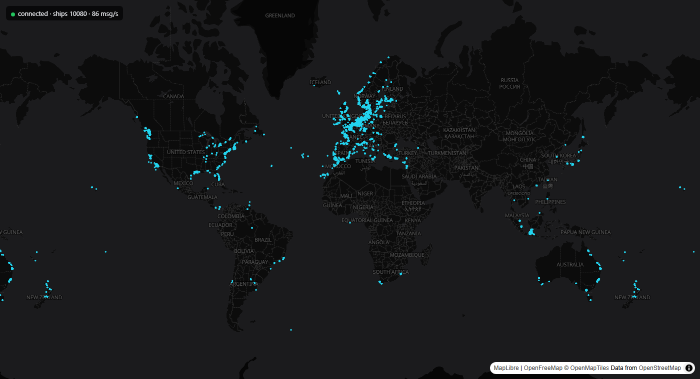

# POSEIDON: frontend

A full-window, flat MapLibre GL JS world map showing live ship positions from the backend WebSocket. Built with Vite, React and TypeScript. An Auth0 login gates the map; the access token is sent as the WebSocket's first message, and the backend checks it.

## Run

Requires a current Node.js (22 or newer), the backend running on `ws://localhost:8000/ws`, and the repo-root `.env` (`cp .env.example .env` at the repo root; the Auth0 values are already filled in).

```sh
npm install
npm run dev
```

Then open http://localhost:5173.

Other scripts: `npm run build` (type-checks, then builds to `dist/`), `npm run preview`, `npm run lint`.

**Smoke test** (`npm run smoke`): logs in through Auth0 with a test user, then fails on a "Worker failed to load" console error, no MapLibre worker, no basemap tiles, or no live ships. It needs the dev server and backend running, plus `AUTH0_TEST_EMAIL` and `AUTH0_TEST_PASSWORD`, read from the root `.env` or the environment. It drives a headed installed Edge (`SMOKE_BROWSER` to change it), because headless Chromium here has no WebGL2.

**MapLibre worker:** `src/App.tsx` calls `setWorkerUrl` with the worker file imported as `?url`. Without it, Vite's dependency pre-bundling moves MapLibre into `node_modules/.vite/deps`, where its relative worker URL breaks: the map goes black with "Worker failed to load". If it happens anyway, restart with `npm run dev -- --force`.

## Environment variables

Set in the repo-root `.env` (`vite.config.ts` has `envDir: '..'`). Only `VITE_` variables reach the browser. Keep the dev server on port 5173: it is the callback, logout and web origin URL registered in Auth0.

| Variable | Default | Purpose |
|---|---|---|
| `VITE_WS_URL` | `ws://localhost:8000/ws` | Backend WebSocket URL. |
| `VITE_AUTH0_DOMAIN` | required | Auth0 tenant domain. |
| `VITE_AUTH0_CLIENT_ID` | required | Auth0 SPA client ID. |
| `VITE_AUTH0_AUDIENCE` | required | Auth0 API audience (identifier); must match the backend's `AUTH0_AUDIENCE`. |

## What it does

- Shows a login button until Auth0 says you're signed in, then the map with a log-out link in the status line.
- Connects to the WebSocket, sends `{type: 'auth', token}` first, and keeps a map of vessels keyed by `mmsi`. A `snapshot` replaces the map, a `delta` upserts `vessels` and deletes `removed`. Other message types are ignored for now.
- If a `seq` number is skipped, it closes the socket and reconnects to get a fresh snapshot.
- On close, it reconnects with backoff: 1 s, doubling to a 15 s maximum.
- Ships are one GeoJSON source drawn as a `circle` layer. The source is updated once per snapshot or delta.
- Clicking a ship opens a popup with name, MMSI, IMO, ship type, speed, course, destination and last-seen time. The destination and numeric ship type come from a `detail` request to the server. The cursor turns into a pointer over ships.
- The status line (top left) shows connection state, the number of ships shown, and messages per second.

Types follow the backend contract in `src/types.ts`.


