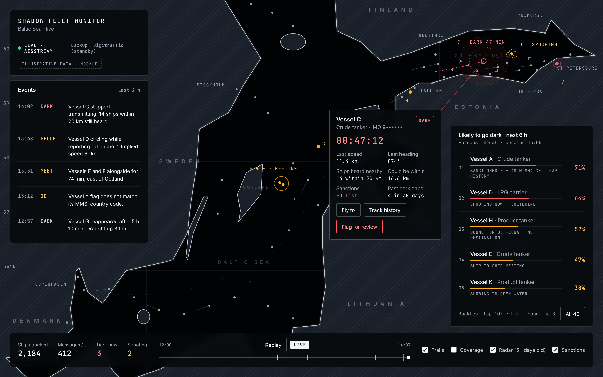
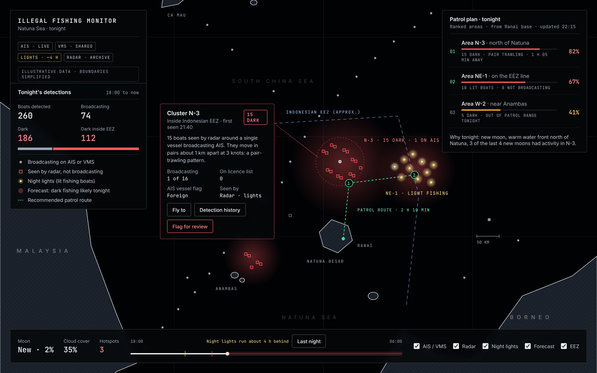
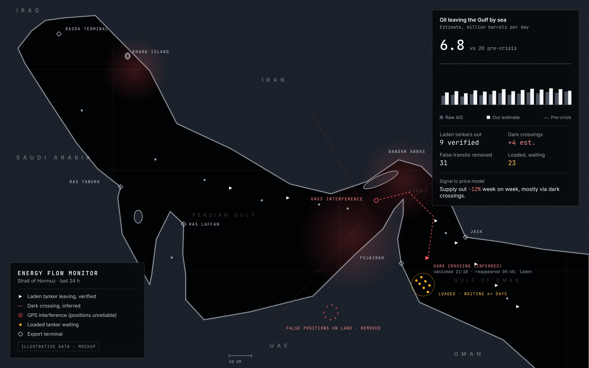

# Chosen project: Dark Vessel Monitor (working title)
*Decided at HackTheBurgh XIII, 7 Nov 2026. Final name and logo still to be chosen.*

**One line:** a live map of the Baltic that spots ships hiding from tracking (switching off or faking their AIS signal), forecasts which ones will go dark next, and ranks them for inspection.

## Why it hits both tracks
- **G-Research (something hard to observe):** sanctions-busting "shadow fleet" tankers deliberately hide. We show *what* is hidden (dark gaps, faked positions), *how* we find it (silence while nearby ships are still heard, impossible tracks), and *what we do* with it (a ranked watchlist).
- **HRT (predictions and decisions):** we take in live streams (two AIS feeds), combine them with alternative data (sanctions lists, historical AIS, satellite radar), forecast the next 6 hours, and make an automated "inspect next" decision, scored against simple baselines.

## Screens (mockups, illustrative data)

*Live Baltic map. This is what we build and demo.*

*Illegal fishing, Natuna Sea (Southeast Asia). Future extension: satellite-based, hours to days behind, not live.*

*Energy flows, Strait of Hormuz. Future extension: an oil-market signal, shown as a historical study.*

## How it works
1. **Detect (live, minutes):** a ship that was reporting every 2 to 10 s goes quiet while ships around it are still heard, so it switched off, not lost coverage. Spoofing shows up as impossible speed jumps or circling while "at anchor".
2. **Forecast (next 6 h):** probability each ship goes dark, learned from Danish historical AIS. Features: loitering, heading to or from Primorsk/Ust-Luga, near transfer spots, blank or changing destination, past gaps, sanctions match, flag/MMSI mismatch, time of day.
3. **Decide:** ranked "inspect next" watchlist refreshed every few minutes, plus alerts.
4. **Prove it:** precision in the top 10 vs baselines ("ships that went dark before", "all tankers near Russian ports"), calibration, hours of warning. Forecasts made early in the hackathon scored by demo time.

## What is live and what is not
| Part | Live? |
| --- | --- |
| Ship positions, gap and spoofing detection, risk scores, watchlist | Yes, seconds to minutes |
| Sanctions match | Yes (IMO arrives every ~6 min; list updated daily) |
| Satellite radar layer | No, at least 5 days old |
| Danish historical data | Training and backtesting only |
| Replay mode | Fallback if feeds die, labelled "Replay" on screen |

## Data sources
| Source | Use | Notes |
| --- | --- | --- |
| AISStream | Live AIS | `wss://stream.aisstream.io/v0/stream`; free key via GitHub; subscribe within 3 s; max 3 connections per account and per IP; no browser connections (needs our relay); no replay; outage in Aug 2026 |
| Digitraffic (Finland) | Backup live feed, Baltic | MQTT over WebSocket `wss://meri.digitraffic.fi:443/mqtt`, topic `vessels-v2/+/location`; send a `Digitraffic-User` header or get throttled |
| Danish Maritime Authority | Historical AIS for training | Daily CSVs, ~0.5 to 2.6 GB each |
| OpenSanctions maritime CSV | Ground truth: sanctioned ships | IMO, MMSI, flag; daily; free non-commercial |
| Global Fishing Watch | Gap events, satellite radar detections | Token issued instantly; free non-commercial |

## Tech stack
- **Backend:** Python asyncio ingest, FastAPI WebSocket (1 update/s to browser), raw log to disk for replay
- **Model:** Polars features, LightGBM / logistic regression
- **Frontend:** React, MapLibre (globe), deck.gl (ships, `TripsLayer` trails, ghost circles), OpenFreeMap dark basemap

## Build plan (24 h)
| Hours | Milestone |
| --- | --- |
| 0 to 2 | Live Baltic data flowing and logged; sanctions CSV joined |
| 2 to 8 | Fallback feed; gap and spoofing detectors; live map with ships and trails |
| 8 to 14 | Forecast trained and backtested on Danish data |
| 14 to 18 | Watchlist, replay mode, radar layer; **feature freeze at 18** |
| 18 to 24 | Polish, backup video, two timed rehearsals |

| Role | Owns |
| --- | --- |
| Data | Feeds, failover, logging, sanctions join |
| Model | Detection, forecast, backtest numbers |
| Frontend | Map, panels, animations |
| Pitch | Story, slides, documented cases, backup video |

## Demo (3 min)
Globe with live counters, fly into the Gulf of Finland, a tanker goes silent and its "could be anywhere in here" circle grows, click it (sanctions match, flag mismatch, draught jump), spoofing case, watchlist, results table vs baselines, close. Framing: a ranked list for human review, never an accusation.

## Risks and fixes
| Risk | Fix |
| --- | --- |
| Coverage gaps look like dark ships | Only flag gaps when nearby ships are still heard; map real coverage from logs |
| Receiver outage or GPS jamming | Many ships silent or jumping at once = receiver/jamming, one ship alone = behaviour |
| Feed silent with no error | 30 s watchdog, auto-switch to Digitraffic, replay |
| Shared venue IP (3 connections) | Ingest over a phone hotspot; backoff with jitter |
| Our code falls behind (fake gaps) | Separate reader and processing; drop gaps during our own stalls |
| Anchored ships look dark (report every 3 min) | Threshold relative to each ship's expected rate |
| Few real events in 24 h | Replay historical cases; also forecast spoofing |
| Few labelled examples | Split train/test by vessel; report sample sizes; always compare with baselines |

**Cannot fix, say it openly:** we cannot prove intent; we only see ships near receivers; radar data is days old.

## First-hour checklist
- [ ] AISStream key works; Baltic messages within 10 min; measure messages/s
- [ ] Digitraffic connects
- [ ] Phone hotspot for ingest; ingest laptop set never to sleep (`caffeinate -dims`)
- [ ] Plot an hour of positions to map real coverage
- [ ] Join OpenSanctions to live IMOs: how many sanctioned ships in the Baltic now?
- [ ] Download one Danish day; loads in Polars
- [ ] Start raw logging and leave it running

## Competition and our edge
Palantir (**Gotham** for government/defence, **Foundry** for commercial, plus Apollo and AIP) is the platform a navy or bank would run this on, not a direct rival. The real incumbents: **Windward** (sanctions, paid), **Skylight by Ai2** (illegal fishing, free), **Kpler / Vortexa / Kayrros** (tanker flows for traders). As a business it is mostly done; as a hackathon entry our edge is transparency: every flag shows its evidence, free data only, and a published forecast score.
**If asked "isn't this just Windward?":** "Yes, the category exists. We built an open, testable version in a day, and here is how accurate it is."

## Future extensions
- **Southeast Asia illegal fishing:** boats that never broadcast, so detect them from space (radar, night lights) and flag the silent ones; decision becomes "where to patrol tonight". ~75% of industrial fishing vessels are not publicly tracked (GFW, Nature 2024).
- **Strait of Hormuz / oil markets:** ~20 m barrels/day normally; largely closed since 28 Feb 2026 and heavily jammed (61% of logged transits in Aug were false, per Windward). Remove false transits, estimate dark crossings, feed an oil supply estimate into a price model. Also: Malaysia ship-to-ship hub, Bab el-Mandeb, Russian ports.

## Ideas we considered and dropped
- **Curtailment Oracle** (Scottish wind curtailment): already published by Wasted Wind, REF and NESO, so weak on "hidden".
- **Who Knew First** (Polymarket informed flow), **Distress Radar** (Companies House), **Attention Firehose** (Wikipedia edits), **Burnout Oracle / Room Pulse** (own keystroke data), **Ghost Buses** (TfE API closed to new users).

## Links
- [Pitch Plan: Dark Vessel Monitor](https://claude.ai/artifact/MGb3DNWfhArgc67isv77Vn)
- [Dashboard Mockups](https://claude.ai/artifact/DANUW4RonKPRC9WgEP9nWU)
- [API and Visualisation Research](https://claude.ai/artifact/JvJSDzY27cphTPeFjnbGCs)

